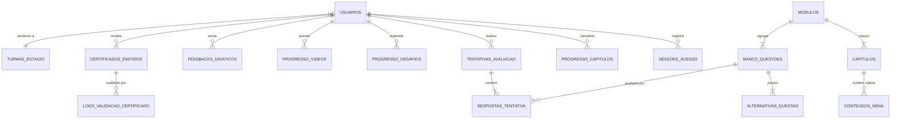

# Projeto de Banco de Dados e Roadmap de Evolução — Portal do Desenvolvedor SEMOB-DF

> **Subsecretaria de Tecnologia da Informação (SUTINF) / Secretaria de Estado de Transporte e Mobilidade (SEMOB-DF)**  
> **Documento:** Engenharia de Dados & Arquitetura de Expansão Tecnológica  
> **Banco Alvo:** PostgreSQL 16 (com suporte a PostGIS e UUID-OSSP)  
> **Versão:** 3.0 (Enterprise Ready)

---

## 1. Visão Geral das Metas de Evolução

Com a validação positiva da V1/V2, o Portal do Desenvolvedor passa de um protótipo didático para um **Sistema Corporativo de Gestão de Aprendizagem Técnica (LMS - Learning Management System)** da SUTINF.

### Pilares Fundamentais:
1. **Didática Enriquecida:** Manuais estruturados em formato de *microlearning* (capítulos objetivos, checkpoints imediatos e vídeos explicativos embutidos).
2. **Controle e Telemetria em Banco de Dados:** Registro de tempo gasto em tela, taxas de evasão, progresso real e histórico de tentativas de avaliação.
3. **Gestão e Painel do Supervisor (Dashboard SUTINF):** Visão analítica para chefias e coordenadores sobre o rendimento de estagiários e desenvolvedores mirins.
4. **Ciclo de Feedback Contínuo (NPS & Opiniões):** Coleta ativa de críticas e dúvidas de cada módulo para retroalimentar o material didático.
5. **Certificação de Alta Fidelidade (Impressão & Persistência):** Armazenamento imutável de certificados com hash criptográfico e formatação milimétrica para impressão em A4 paisagem ou geração de PDF no servidor.
6. **Banco de Questões Parametrizado:** Sorteio dinâmico por dificuldade e cobertura abrangente de todo o conteúdo da trilha.

---

## 2. Diagrama Entidade-Relacionamento (DER Lógico)



---

## 3. DDL SQL Completo (PostgreSQL 16)

O script a seguir implementa o esquema normalizado em terceira forma normal (3FN), com índices de performance, constraints de integridade e campos `JSONB` para flexibilidade controlada.

```sql
-- ============================================================================
-- EXTENSÕES NECESSÁRIAS
-- ============================================================================
CREATE EXTENSION IF NOT EXISTS "uuid-ossp";
CREATE EXTENSION IF NOT EXISTS "citext"; -- Para e-mails case-insensitive

-- ============================================================================
-- 1. DOMÍNIO: USUÁRIOS, TURMAS E PERMISSÕES (RBAC)
-- ============================================================================

CREATE TYPE tipo_papel_usuario AS ENUM (
    'ESTAGIARIO',
    'DESENVOLVEDOR_JUNIOR',
    'SUPERVISOR_TECNICO',
    'GESTOR_SUTINF',
    'ADMINISTRADOR_SISTEMA'
);

CREATE TABLE turmas_estagio (
    id UUID PRIMARY KEY DEFAULT uuid_generate_v4(),
    codigo_semestre VARCHAR(10) NOT NULL UNIQUE, -- Ex: '2026-1', '2026-2'
    descricao VARCHAR(100) NOT NULL,
    data_inicio DATE NOT NULL,
    data_termino_prevista DATE NOT NULL,
    ativo BOOLEAN DEFAULT TRUE,
    criado_em TIMESTAMP WITH TIME ZONE DEFAULT CURRENT_TIMESTAMP
);

CREATE TABLE usuarios (
    id UUID PRIMARY KEY DEFAULT uuid_generate_v4(),
    matricula VARCHAR(20) UNIQUE,
    nome_completo VARCHAR(150) NOT NULL,
    email CITEXT UNIQUE NOT NULL,
    senha_hash VARCHAR(255) NOT NULL,
    papel tipo_papel_usuario NOT NULL DEFAULT 'ESTAGIARIO',
    turma_id UUID REFERENCES turmas_estagio(id) ON DELETE SET NULL,
    instituicao_ensino VARCHAR(120),
    supervisor_responsavel_id UUID REFERENCES usuarios(id) ON DELETE SET NULL,
    avatar_url TEXT,
    ativo BOOLEAN DEFAULT TRUE,
    criado_em TIMESTAMP WITH TIME ZONE DEFAULT CURRENT_TIMESTAMP,
    atualizado_em TIMESTAMP WITH TIME ZONE DEFAULT CURRENT_TIMESTAMP
);

CREATE TABLE sessoes_acesso (
    id UUID PRIMARY KEY DEFAULT uuid_generate_v4(),
    usuario_id UUID NOT NULL REFERENCES usuarios(id) ON DELETE CASCADE,
    ip_origem VARCHAR(45),
    user_agent TEXT,
    data_login TIMESTAMP WITH TIME ZONE DEFAULT CURRENT_TIMESTAMP,
    data_ultimo_heartbeat TIMESTAMP WITH TIME ZONE DEFAULT CURRENT_TIMESTAMP,
    data_logout TIMESTAMP WITH TIME ZONE
);

CREATE INDEX idx_usuarios_email ON usuarios(email);
CREATE INDEX idx_usuarios_papel ON usuarios(papel);
CREATE INDEX idx_usuarios_turma ON usuarios(turma_id);

-- ============================================================================
-- 2. DOMÍNIO: ESTRUTURA DIDÁTICA (MÓDULOS, CAPÍTULOS E VÍDEOS)
-- ============================================================================

CREATE TYPE tipo_midia AS ENUM ('YOUTUBE', 'VIMEO', 'STREAM_GDF', 'MP4_STORAGE');

CREATE TABLE modulos (
    id VARCHAR(50) PRIMARY KEY, -- Ex: 'git-flow', 'banco-dados', 'backend-nest'
    titulo VARCHAR(150) NOT NULL,
    descricao TEXT NOT NULL,
    icone VARCHAR(50) NOT NULL,
    ordem_trilha INT NOT NULL UNIQUE,
    tempo_estimado_minutos INT NOT NULL DEFAULT 60,
    obrigatorio_certificado BOOLEAN DEFAULT TRUE,
    ativo BOOLEAN DEFAULT TRUE
);

CREATE TABLE capitulos (
    id UUID PRIMARY KEY DEFAULT uuid_generate_v4(),
    modulo_id VARCHAR(50) NOT NULL REFERENCES modulos(id) ON DELETE CASCADE,
    slug VARCHAR(80) NOT NULL,
    titulo VARCHAR(150) NOT NULL,
    ordem INT NOT NULL,
    conteudo_markdown TEXT NOT NULL,
    tempo_leitura_estimado_min INT DEFAULT 10,
    ativo BOOLEAN DEFAULT TRUE,
    UNIQUE(modulo_id, slug),
    UNIQUE(modulo_id, ordem)
);

CREATE TABLE conteudos_midia (
    id UUID PRIMARY KEY DEFAULT uuid_generate_v4(),
    capitulo_id UUID NOT NULL REFERENCES capitulos(id) ON DELETE CASCADE,
    tipo tipo_midia NOT NULL DEFAULT 'STREAM_GDF',
    titulo VARCHAR(150) NOT NULL,
    url_midia TEXT NOT NULL,
    duracao_segundos INT NOT NULL,
    ordem INT NOT NULL DEFAULT 1,
    obrigatorio BOOLEAN DEFAULT FALSE,
    transcricao_resumo TEXT
);

CREATE TABLE progresso_capitulos (
    id UUID PRIMARY KEY DEFAULT uuid_generate_v4(),
    usuario_id UUID NOT NULL REFERENCES usuarios(id) ON DELETE CASCADE,
    capitulo_id UUID NOT NULL REFERENCES capitulos(id) ON DELETE CASCADE,
    lido BOOLEAN DEFAULT TRUE,
    tempo_gasto_segundos INT DEFAULT 0,
    concluido_em TIMESTAMP WITH TIME ZONE DEFAULT CURRENT_TIMESTAMP,
    UNIQUE(usuario_id, capitulo_id)
);

CREATE TABLE progresso_videos (
    id UUID PRIMARY KEY DEFAULT uuid_generate_v4(),
    usuario_id UUID NOT NULL REFERENCES usuarios(id) ON DELETE CASCADE,
    midia_id UUID NOT NULL REFERENCES conteudos_midia(id) ON DELETE CASCADE,
    segundos_assistidos INT DEFAULT 0,
    percentual_assistido INT DEFAULT 0, -- 0 a 100
    concluido BOOLEAN DEFAULT FALSE,
    atualizado_em TIMESTAMP WITH TIME ZONE DEFAULT CURRENT_TIMESTAMP,
    UNIQUE(usuario_id, midia_id)
);

-- ============================================================================
-- 3. DOMÍNIO: BANCO DE QUESTÕES E AVALIAÇÕES DE DESEMPENHO
-- ============================================================================

CREATE TYPE nivel_dificuldade AS ENUM ('FACIL', 'MEDIO', 'AVANCADO');

CREATE TABLE banco_questoes (
    id UUID PRIMARY KEY DEFAULT uuid_generate_v4(),
    modulo_id VARCHAR(50) NOT NULL REFERENCES modulos(id) ON DELETE RESTRICT,
    capitulo_id UUID REFERENCES capitulos(id) ON DELETE SET NULL,
    enunciado TEXT NOT NULL,
    snippet_codigo TEXT,
    linguagem_codigo VARCHAR(30), -- 'sql', 'typescript', 'bash', 'json'
    dificuldade nivel_dificuldade NOT NULL DEFAULT 'MEDIO',
    categoria_topico VARCHAR(80) NOT NULL, -- Ex: 'Git Rebase', 'PostGIS ST_Contains'
    explicacao_didatica TEXT NOT NULL,
    ativo BOOLEAN DEFAULT TRUE,
    criado_em TIMESTAMP WITH TIME ZONE DEFAULT CURRENT_TIMESTAMP
);

CREATE TABLE alternativas_questao (
    id UUID PRIMARY KEY DEFAULT uuid_generate_v4(),
    questao_id UUID NOT NULL REFERENCES banco_questoes(id) ON DELETE CASCADE,
    letra_opcao CHAR(1) NOT NULL, -- 'A', 'B', 'C', 'D'
    texto_opcao TEXT NOT NULL,
    eh_correta BOOLEAN NOT NULL DEFAULT FALSE,
    UNIQUE(questao_id, letra_opcao)
);

CREATE TABLE tentativas_avaliacao (
    id UUID PRIMARY KEY DEFAULT uuid_generate_v4(),
    usuario_id UUID NOT NULL REFERENCES usuarios(id) ON DELETE CASCADE,
    modulo_id VARCHAR(50) NOT NULL REFERENCES modulos(id) ON DELETE RESTRICT,
    pontuacao_obtida NUMERIC(5, 2) NOT NULL, -- Ex: 85.00 (%)
    aprovado BOOLEAN NOT NULL,
    total_questoes INT NOT NULL,
    total_acertos INT NOT NULL,
    tempo_gasto_segundos INT NOT NULL,
    realizado_em TIMESTAMP WITH TIME ZONE DEFAULT CURRENT_TIMESTAMP
);

CREATE TABLE respostas_tentativa (
    id UUID PRIMARY KEY DEFAULT uuid_generate_v4(),
    tentativa_id UUID NOT NULL REFERENCES tentativas_avaliacao(id) ON DELETE CASCADE,
    questao_id UUID NOT NULL REFERENCES banco_questoes(id) ON DELETE RESTRICT,
    alternativa_escolhida_id UUID REFERENCES alternativas_questao(id) ON DELETE RESTRICT,
    acertou BOOLEAN NOT NULL
);

CREATE INDEX idx_questoes_modulo ON banco_questoes(modulo_id);
CREATE INDEX idx_tentativas_usuario ON tentativas_avaliacao(usuario_id);

-- ============================================================================
-- 4. DOMÍNIO: DESAFIOS PRÁTICOS (SQL, BACK-END E FRONT-END)
-- ============================================================================

CREATE TABLE catalogo_desafios_praticos (
    id VARCHAR(50) PRIMARY KEY, -- 'sql-25-queries', 'backend-nest-crud', 'frontend-infonibus'
    titulo VARCHAR(150) NOT NULL,
    tipo VARCHAR(30) NOT NULL, -- 'SQL', 'BACKEND', 'FRONTEND'
    descricao TEXT NOT NULL,
    peso_avaliacao NUMERIC(3, 2) DEFAULT 1.0
);

CREATE TABLE progresso_desafios (
    id UUID PRIMARY KEY DEFAULT uuid_generate_v4(),
    usuario_id UUID NOT NULL REFERENCES usuarios(id) ON DELETE CASCADE,
    desafio_id VARCHAR(50) NOT NULL REFERENCES catalogo_desafios_praticos(id),
    submissao_codigo TEXT,
    respostas_json JSONB, -- Registra quais das 25 questões foram concluídas
    percentual_concluido INT DEFAULT 0,
    aprovado BOOLEAN DEFAULT FALSE,
    data_conclusao TIMESTAMP WITH TIME ZONE,
    UNIQUE(usuario_id, desafio_id)
);

-- ============================================================================
-- 5. DOMÍNIO: FEEDBACK DIDÁTICO E OPINIÕES (NPS & MELHORIA CONTÍNUA)
-- ============================================================================

CREATE TABLE feedbacks_didaticos (
    id UUID PRIMARY KEY DEFAULT uuid_generate_v4(),
    usuario_id UUID NOT NULL REFERENCES usuarios(id) ON DELETE SET NULL,
    modulo_id VARCHAR(50) REFERENCES modulos(id) ON DELETE SET NULL,
    capitulo_id UUID REFERENCES capitulos(id) ON DELETE SET NULL,
    nota_clareza INT CHECK (nota_clareza BETWEEN 1 AND 5),
    nota_dificuldade INT CHECK (nota_dificuldade BETWEEN 1 AND 5),
    nps_recomendacao INT CHECK (nps_recomendacao BETWEEN 0 AND 10),
    comentario_pontos_fortes TEXT,
    comentario_duvidas_restantes TEXT,
    sugestao_melhoria TEXT,
    status_leitura VARCHAR(30) DEFAULT 'NAO_LIDO', -- 'NAO_LIDO', 'EM_ANALISE', 'IMPLEMENTADO'
    criado_em TIMESTAMP WITH TIME ZONE DEFAULT CURRENT_TIMESTAMP
);

CREATE INDEX idx_feedbacks_modulo ON feedbacks_didaticos(modulo_id);
CREATE INDEX idx_feedbacks_status ON feedbacks_didaticos(status_leitura);

-- ============================================================================
-- 6. DOMÍNIO: CERTIFICADOS OFICIAIS E AUDITORIA PÚBLICA
-- ============================================================================

CREATE TABLE certificados_emitidos (
    id UUID PRIMARY KEY DEFAULT uuid_generate_v4(),
    usuario_id UUID NOT NULL REFERENCES usuarios(id) ON DELETE RESTRICT,
    codigo_autenticidade VARCHAR(50) UNIQUE NOT NULL, -- Ex: 'SEMOB-2026-D4E89F12'
    codigo_crc32 VARCHAR(10) NOT NULL,
    hash_sha256 VARCHAR(64) NOT NULL,
    processo_sei VARCHAR(50) NOT NULL DEFAULT '00090-00012485/2026-11',
    carga_horaria_horas INT NOT NULL DEFAULT 40,
    media_final_ponderada NUMERIC(5, 2) NOT NULL,
    supervisor_assinante_id UUID REFERENCES usuarios(id) ON DELETE RESTRICT,
    caminho_arquivo_pdf TEXT,
    status VARCHAR(20) DEFAULT 'VALIDO', -- 'VALIDO', 'REVOGADO'
    emitido_em TIMESTAMP WITH TIME ZONE DEFAULT CURRENT_TIMESTAMP
);

CREATE TABLE logs_validacao_certificado (
    id UUID PRIMARY KEY DEFAULT uuid_generate_v4(),
    certificado_id UUID NOT NULL REFERENCES certificados_emitidos(id) ON DELETE CASCADE,
    ip_solicitante VARCHAR(45),
    user_agent TEXT,
    validado_em TIMESTAMP WITH TIME ZONE DEFAULT CURRENT_TIMESTAMP
);

CREATE INDEX idx_certificados_codigo ON certificados_emitidos(codigo_autenticidade);
CREATE INDEX idx_certificados_usuario ON certificados_emitidos(usuario_id);
```

---

## 4. Análise e Solução Técnica dos Requisitos

### 4.1 Aprimoramento da Didática: "Guia Passo a Passo Vivo"
* **Problema Atual:** Manuais longos em formato texto demandam leitura passiva e geram cansaço cognitivo.
* **Solução:**
  1. **Fragmentação em Capítulos Curtos (Microlearning):** Em vez de 1 manual de 3.000 palavras, dividi-lo em 5 a 7 capítulos de 5 a 10 minutos cada.
  2. **Checkpoints Interativos de Fixação:** Ao final de cada capítulo, o aluno responde a 1 pergunta rápida do tipo *"Qual o resultado deste comando?"* antes de avançar.
  3. **Caixas de Contexto Institucional:**
     - `💡 Como a SEMOB usa isso:` Explicando a aplicação real no SISMOB ou no CCO da Rodoviária do Plano Piloto.
     - `⚠️ Erro mais comum no GDF:` Explicando armadilhas de branches, merge sem rebase ou joins cartesianos no PostgreSQL.

---

### 4.2 Vídeos Explicativos nas Trilhas
* **Estrutura de Vídeo:**
  - Vídeos curtos de 3 a 8 minutos gravados pela equipe da SUTINF (ex: *Screen recording* demonstrando o git clone, a navegação no DBeaver no banco de mobilidade, ou o debug de um controller NestJS).
* **Player Inteligente:**
  - Integração com `progresso_videos`: a plataforma armazena o ponto em que o aluno parou (`segundos_assistidos`).
  - O capítulo só é marcado como concluído se o aluno assistir a pelo menos 85% do vídeo ou responder ao checkpoint associado.

---

### 4.3 Gestão e Painel do Supervisor (Métricas & KPIs)
O supervisor técnico necessita de uma tela exclusiva com:
1. **Quadro de Turma:** Listagem dos estagiários com barra de progresso individual, data de início e última atividade.
2. **Matriz de Dificuldade Técnica:** Gráfico de barras indicando quais módulos e questões possuem as menores taxas de acerto na primeira tentativa.
3. **Indicador de Ritmo (Pacing):** Alerta visual em estagiários que não acessam a plataforma há mais de 3 dias úteis.
4. **Exportação de Relatório Semestral para o SEI:** Botão que gera automaticamente a minuta do *Relatório de Avaliação do Estagiário* contendo todas as notas, desafios cumpridos e carga horária para assinatura no SEI-GDF.

---

### 4.4 Aba de Opiniões e Feedbacks (NPS Educacional)
* **Objetivo:** Garantir que o material se mantenha atualizado e amigável.
* **Métricas Coletadas:**
  - Escala de Clareza (1 a 5 estrelas);
  - Nível de Dificuldade (Muito Fácil a Excessivamente Difícil);
  - NPS (*"Qual a probabilidade de você recomendar este manual para um novo estagiário?"* - 0 a 10);
  - Comentário aberto: *"Em qual passo você travou ou teve dúvidas?"*.
* **Painel Administrativo:** Permite à equipe da SUTINF filtrar feedbacks por módulo para identificar rapidamente parágrafos confusos ou scripts com dependências desatualizadas.

---

### 4.5 Certificado Oficial com Fidelidade de Impressão (CSS & Back-end)

#### O Desafio da Impressão no Navegador
Quando o aluno clica em `Ctrl + P`, o navegador por padrão pode inserir cabeçalhos com URLs, quebrar o documento em 2 páginas ou cortar bordas dependendo do modelo da impressora.

#### A Solução em 2 Camadas:

##### 1. Blindagem CSS `@media print` no Front-end:
```css
@page {
  size: A4 landscape; /* 297mm x 210mm */
  margin: 0;          /* Remove margens do navegador */
}

@media print {
  body {
    background: #ffffff !important;
    margin: 0 !important;
    padding: 0 !important;
    -webkit-print-color-adjust: exact !important;
    print-color-adjust: exact !important;
  }

  /* Oculta tudo que não seja a folha do certificado */
  nav, footer, .no-print, .btn, .theme-toggle {
    display: none !important;
  }

  .certificate-sheet {
    width: 297mm !important;
    height: 209mm !important; /* 1mm de segurança para evitar 2ª página em branco */
    page-break-after: avoid !important;
    page-break-inside: avoid !important;
    box-shadow: none !important;
    border-radius: 0 !important;
  }
}
```

##### 2. Geração de PDF Idêntico no Servidor (Back-end NestJS):
* Endpoint: `GET /api/certificates/:codigo/download-pdf`
* O servidor utiliza o **Puppeteer** ou **PDFKit** para renderizar o componente em resolução 300 DPI, convertendo em PDF vetorial.
* Vantagem: O estagiário e o supervisor recebem um arquivo PDF oficial idêntico, com metadados institucionais embutidos e carimbo de tempo inviolável.

---

### 4.6 Banco de Questões Robusto (Perguntas Abrangentes)
Em vez de 5 perguntas fixas por módulo:
* O novo banco armazena **20 a 30 questões por módulo**, categorizadas por tópico (`Git Branches`, `Git Rebase`, `Git Stash`, `PostGIS`, `NestJS DTOs`, `JWT Guard`, `React Hooks`).
* Cada avaliação sorteia aleatoriamente:
  - 3 questões fáceis;
  - 4 questões médias;
  - 3 questões avançadas.
* Isso impede que estagiários decorem a sequência de respostas em tentativas consecutivas e garante uma avaliação profunda do aprendizado.

---

## 5. Estratégia de Extensibilidade e Novas Tecnologias

A arquitetura do banco e dos serviços foi desenhada para suportar evoluções futuras sem refatorações drásticas:

1. **IA Tutora SUTINF (RAG - Retrieval-Augmented Generation):**
   - Utilizar a extensão `pgvector` no PostgreSQL para armazenar os embeddings dos manuais.
   - Um chat de suporte integrado poderá tirar dúvidas de código do estagiário com base estrita na documentação da SEMOB-DF.
2. **Autenticação Unificada GDF:**
   - O modelo de `usuarios` está pronto para receber `login_social_tipo: 'GOV_BR'` ou integração com o Keycloak / Active Directory corporativo do Governo do Distrito Federal.
3. **Ambiente SQL Interativo no Navegador (WebAssembly):**
   - Futuramente, integrar o SQLite compilado para WebAssembly (PGLite ou SQL.js) para que os 25 desafios de SQL rodem diretamente no navegador do estagiário contra uma base de amostra da SEMOB, validando as queries em tempo real.
